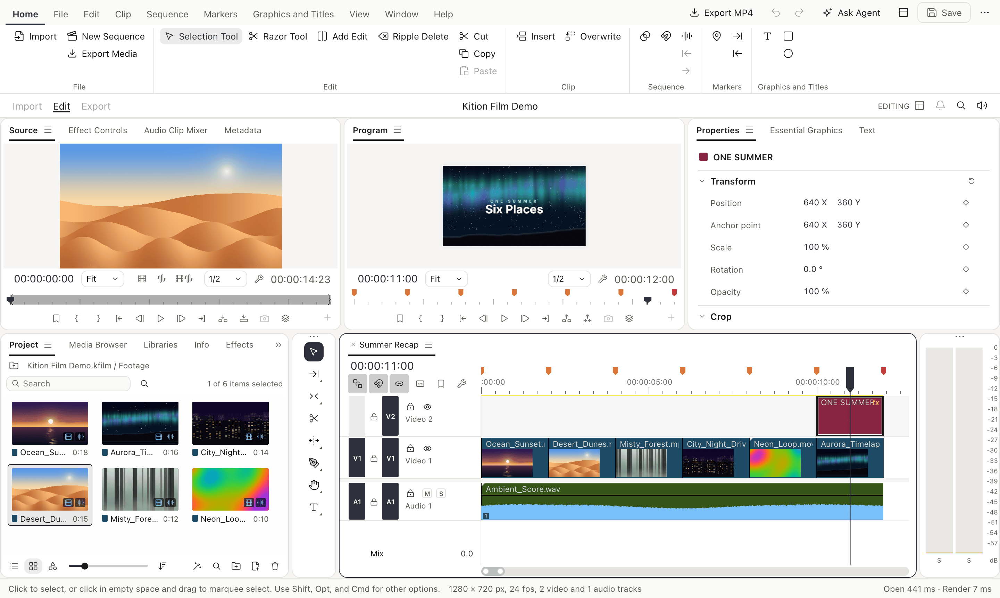
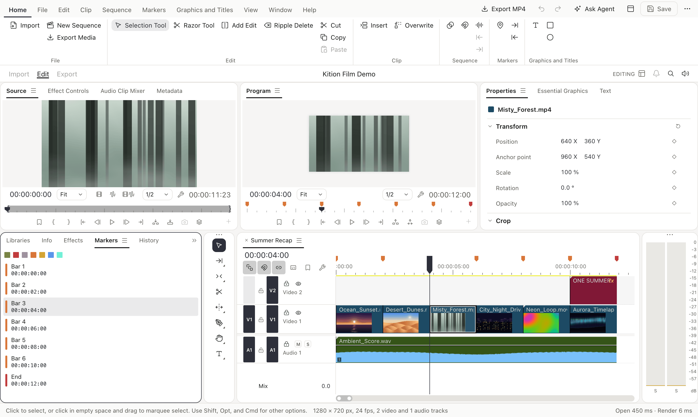
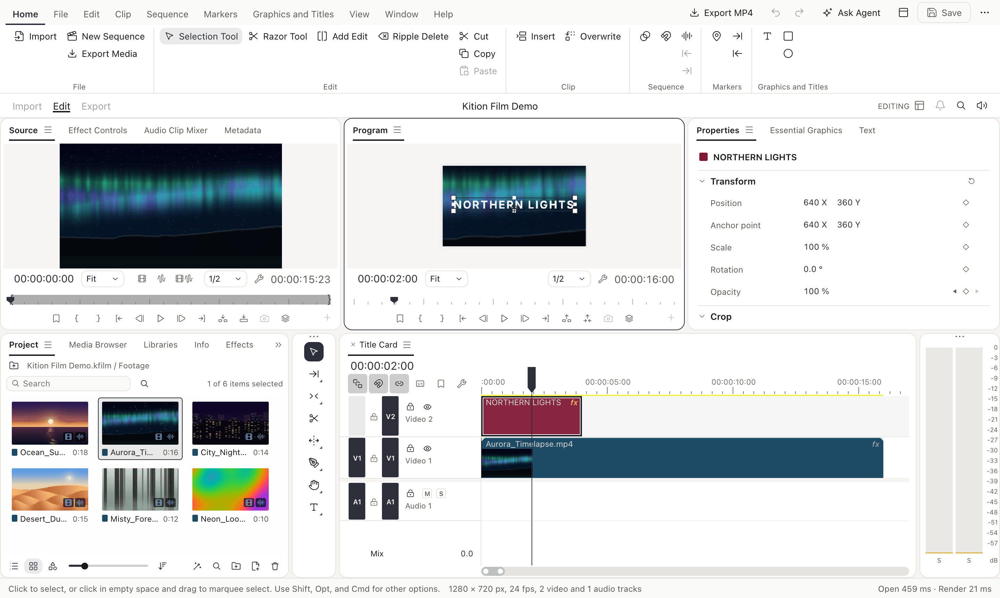
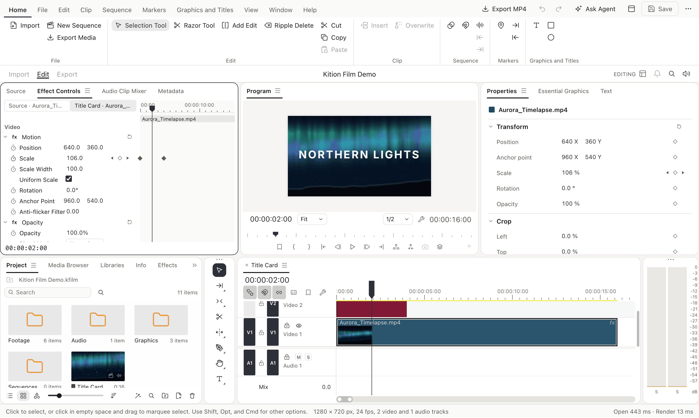
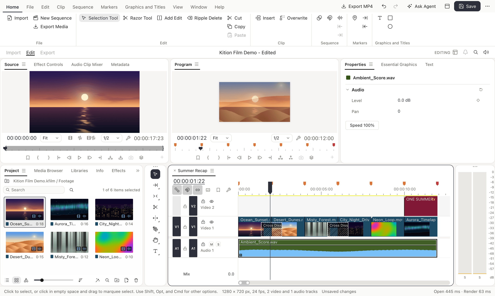
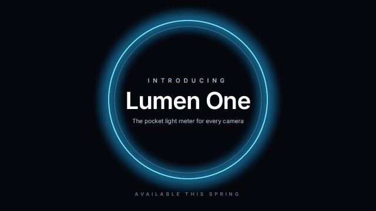
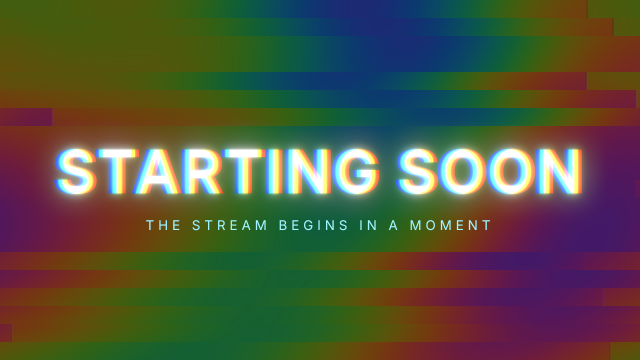

<div align="center">

# Kition Film

**Kition Film: a video timeline editor, for people and AI agents**

Timeline editing · Markers · Titles · Keyframes · Transitions and audio · MCP tools for agents

[](LICENSE)
[](https://www.npmjs.com/package/@kition/embed)
[](https://github.com/kitharness/kitharness)
[](bindings/wasm)

[Use it in Kition](https://kition.ai) · [Embed it](#embed-it-in-your-app) · [Give it to your agent](#give-it-to-your-agent) · [Showcase](https://github.com/KitionAI/kition-showcase/tree/main/film) · [Developer docs](https://developer.kition.ai) · [KHP](https://github.com/kitharness/kitharness)

</div>

A video project usually lives inside the app that made it. The cut, the titles and the keyframes
open nowhere else. A script or an AI agent that should trim a clip or add a title has no project to
read. It has to drive the editor's window or start the cut again.

Film keeps the whole project in one `.kfilm` file: bins, sequences, clips, effects, keyframes and
markers. You cut on a multi-track timeline with Source and Program monitors. An AI agent works on
the same file through the same engine and commands: it reads the timeline, trims in frames, previews
a frame, and checks the project for offline media and gaps.



## What it does

### Why Film

- **Cut on a real timeline.** Video and audio tracks, the razor, trims, clip names and speed. Every
  cut survives saving and opening again.
- **Mark the beat.** Sequence markers with names, colors, comments and durations, and In and Out
  points, all kept in the project.
- **Titles in the frame.** Add a title, Chinese, Japanese and Korean text included, and set its fill,
  scale and rotation. Select it in the Program monitor and move it by its handles.
- **Animate with keyframes.** Effects, their values, keyframes and masks are saved with the clip.
- **Transitions and a mix that stay.** Video and audio transitions, clip gain, volume keyframes,
  track volume and pan, and the mix level are kept in the file.
- **Built for agents, and open source.** An agent edits through MCP tools on the same engine, and
  can work in a draft you review. Apache-2.0, engine and editor.

### See it

<table>
<tr>
<td width="50%"><br /><b>Timeline and markers</b>: six scenes cut on the bar lines of the music, every marker listed and one click away.</td>
<td width="50%"><br /><b>Titles and graphics</b>: select a title layer in the picture and move or scale it by its handles.</td>
</tr>
<tr>
<td width="50%"><br /><b>Keyframes</b>: a slow push-in from two Scale keyframes, edited in Effect Controls.</td>
<td width="50%"><br /><b>Transitions and audio</b>: apply the default transition at a cut, and set a clip's level and pan.</td>
</tr>
</table>

### Made with Film

<table>
<tr>
<td width="25%"><a href="https://github.com/KitionAI/kition-showcase/tree/main/film/product-launch-title"></a></td>
<td width="25%"><a href="https://github.com/KitionAI/kition-showcase/tree/main/film/four-up-video-wall"></a></td>
<td width="25%"><a href="https://github.com/KitionAI/kition-showcase/tree/main/film/neon-glitch-stream-intro"></a></td>
<td width="25%"><a href="https://github.com/KitionAI/kition-showcase/tree/main/film/matchday-versus-split"></a></td>
</tr>
</table>

Every sample is built with Film's own commands. [See all of them](https://github.com/KitionAI/kition-showcase/tree/main/film).

### Formats

| Opens | Creates | Exports |
| --- | --- | --- |
| `.kfilm` | `.kfilm` | `.mp4` |

A project can also start from an `.mp4`, `.mov` or `.webm` clip.

## Quick start

### Use it in Kition

Kition ships Film: a `.kfilm` file in your workspace opens in this editor. Kition's agent edits the
same project with the kit's `film_*` tools. [Download Kition](https://github.com/KitionAI/kition/releases/latest).

### Embed it in your app

Film's editor is a static package you host yourself, mounted into your page with the Kition SDK's
[`@kition/embed`](https://www.npmjs.com/package/@kition/embed). You keep the files and the users;
the editor reads and writes through the functions you give it.

1. Download `kition-film-<version>.tgz` from the
   [latest release](https://github.com/KitionAI/kition-film/releases/latest) and serve its
   `film-ui/` folder as static files on its own origin, with the headers in the
   [embed reference](https://github.com/KitionAI/kition-sdk/blob/main/docs/platform/reference/embed.md).
2. Install the SDK and mount the editor:

```sh
npm install @kition/embed
```

```ts
import { KitionEmbed } from '@kition/embed'

const editor = await KitionEmbed.mount(document.getElementById('film')!, {
  kit: { id: 'kit.film', url: 'https://kits.example.com/film-ui/' }, // the package you host
  file: { id: 'summer-recap', name: 'Summer recap.kfilm' },
  storage: {
    read: async (id) => api.read(id),                    // { bytes, version }
    write: async (id, bytes, { expectedVersion }) =>     // refuse a stale version
      api.write(id, bytes, expectedVersion),             // { version }
  },
})
```

Every save carries the version it read, so an edit made elsewhere is never written over. The
[embed guide](https://github.com/KitionAI/kition-sdk/blob/main/docs/sdk/embed.md) covers identity,
co-editing and an agent working inside the open editor.

### Give it to your agent

The engine also runs headless, and `kition`, the Kition SDK's command line, serves it as MCP tools
(`film_inspect`, `film_run`, `film_check`, ...) on a folder of projects, for any MCP client. Nothing
is compiled: you need neither Rust nor the Kition app. Install `kition`, then connect your agent in
the folder:

```sh
npm install -g @kition/cli        # Node.js 20 or later; gives the kition command
kition agent add claude           # or codex, cursor: registers kition's MCP server
```

Without installing it:
`claude mcp add kition -- npx -y @kition/cli mcp --workspace "$PWD"`. Without Node.js, install
`kition` with `curl -fsSL https://github.com/KitionAI/kition-sdk/releases/latest/download/install.sh | sh`
(Windows: `irm https://github.com/KitionAI/kition-sdk/releases/latest/download/install.ps1 | iex`)
and run the same `kition agent add`.

`kition` holds no kit. The first time the agent opens a `.kfilm` file, through the `kit_inspect`
tool the server offers until Film is installed, `kition` downloads Film's headless executable into
`~/.kition/kits` and the film tools appear. `kition kit install film` downloads it ahead of time,
and `kition kit upgrade` moves it to the newest version. Claude Desktop, Cursor, Codex and the other
commands are in the SDK's
[agent guide](https://github.com/KitionAI/kition-sdk/blob/main/docs/sdk/agent.md#connect-your-agent)
and [`kition` guide](https://github.com/KitionAI/kition-sdk/blob/main/docs/sdk/cli.md). To run a
build of your own (working on the kit itself), see
[docs/development.md](docs/development.md#build-and-test).

A real session on a copy of the showcase montage, abridged:

```text
> film_inspect {"path":"recap.kfilm","preview":false}
Opened `recap.kfilm`: 1280 × 720
  Summer Recap, 7 markers
  V1  60 Ocean_Sunset.mp4 @0f | 61 Desert_Dunes.mp4 @48f | 62 Misty_Forest.mp4 @96f | …
  V2  68 ONE SUMMER @240f
  A1  52 Ambient_Score.wav, gain 0 dB

> film_run {"path":"recap.kfilm","steps":[
    {"command":"sequence.applyVideoTransition","params":{"clip":61,"edge":"in","effect":"cross_dissolve","frames":12}},
    {"command":"sequence.applyAudioTransition","params":{"clip":52,"edge":"out","frames":24}},
    {"command":"clip.audioGain","params":{"clips":[52],"mode":"set","db":-6}}]}
Ran 3 commands on `recap.kfilm` (saved): 1280 × 720 Changes: objects 2 created, 1 changed.

> film_inspect {"path":"recap.kfilm","preview":false}
  V1  transitions: 70 cross_dissolve, 12 frames
  A1  52 Ambient_Score.wav, gain -6 dB; transitions: 71 constant_power, 24 frames

> film_check {"path":"recap.kfilm"}
Checked `recap.kfilm`: the kit found nothing wrong.
```

The track lines are trimmed from the JSON `film_inspect` answers (durations there are in ticks,
254,016,000,000 a second). The agent's guide is [agent/guide.md](agent/guide.md).

## Maturity

Version 0.1.0 · KHP 1.0, conformance level `basic`.

| Works today | Partly there | Not yet |
| --- | --- | --- |
| Razor cuts, trims, track settings, clip names and speed<br />Markers and In/Out points<br />Video and audio transitions<br />Titles with CJK text, fill, scale and rotation<br />Effects with keyframes and masks; clip gain, volume, track volume and pan | Trim mode, roll, slip and slide edits<br />Captions and transcripts<br />Color grading, LUTs and scopes<br />Multi-camera editing<br />Export presets and the export queue | H.265 export<br />Export Frame<br />Preferences<br />Voice-over recording<br />The color grading, graphics template and clip mixer panels |

Known gaps: [docs/gaps.md](docs/gaps.md). What's next: [docs/roadmap.md](docs/roadmap.md).

## Build and contribute

Build and test instructions are in [docs/development.md](docs/development.md). Read
[CONTRIBUTING.md](.github/CONTRIBUTING.md) before opening a pull request, and ask questions in
[Discussions](https://github.com/KitionAI/kition/discussions) or on [Discord](https://discord.gg/bFSjRDjVY).

## License

Apache-2.0 ([LICENSE](LICENSE)). Third-party licenses and notices are listed in [NOTICE](NOTICE)
and [docs/attribution.md](docs/attribution.md).

Portions of this kit are derived from a project licensed under the MIT License, used here under
that license and credited in [NOTICE](NOTICE).
